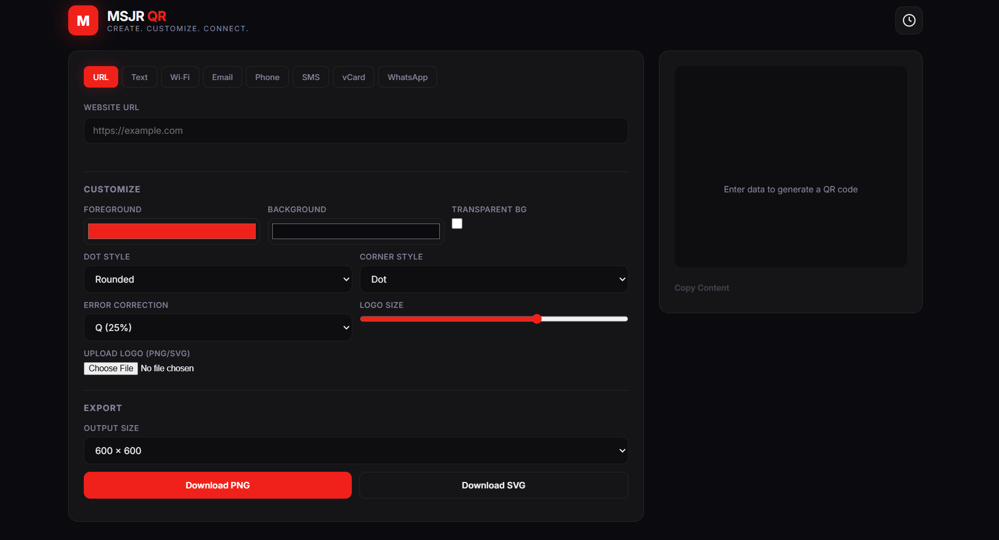
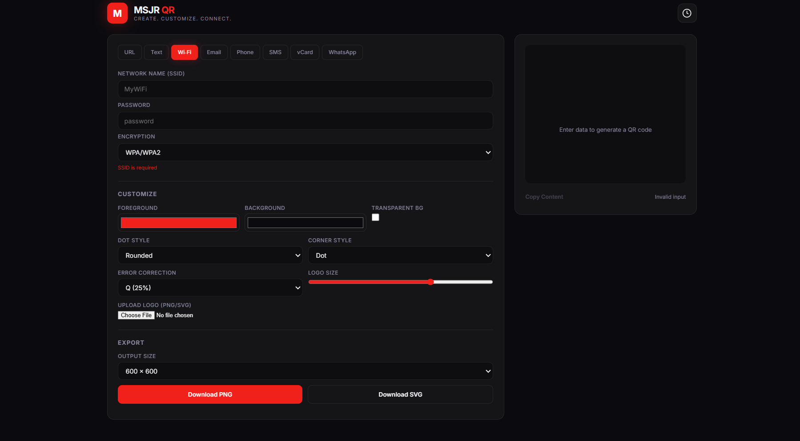
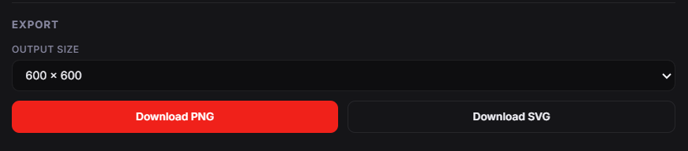
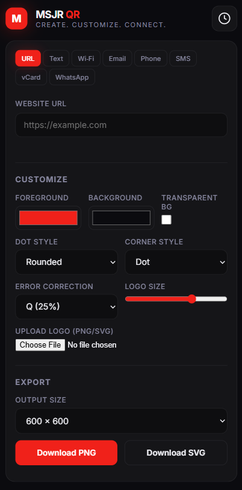

# MSJR QR

### Create. Customize. Connect.

A modern, customizable QR Code Generator built with HTML, CSS, and Vanilla JavaScript.

MSJR QR lets you create, customize, preview, and download QR codes through a clean, responsive interface.

## Preview



### Wi-Fi QR Code


### Export Options


### Mobile View


## Features

- Generate QR codes for:
  - URLs
  - Plain text
  - Wi-Fi networks
  - Email
  - Phone numbers
  - SMS
  - vCards
  - WhatsApp
- Customize foreground and background colors
- Transparent background option
- Customize QR code dot and corner styles
- Choose error correction levels
- Add a custom logo
- Live QR code preview
- Export QR codes as PNG or SVG
- Multiple export sizes
- Copy QR content
- QR code history using localStorage
- Responsive interface

## Built With

- HTML5
- CSS3
- Vanilla JavaScript (ES6+)
- [QR Code Styling](https://github.com/kozakdenys/qr-code-styling)
- Google Fonts — Inter

## Project Structure

```text
msjr-qr/
├── index.html
├── README.md
├── css/
│   └── style.css
├── js/
│   ├── app.js
│   ├── qr-generator.js
│   ├── history.js
│   └── ui.js
└── assets/
    └── images/
        ├── screenshot.png
        ├── screenshot-wifi.png
        ├── screenshot-export.png
        └── screenshot-mobile.png
```

## Getting Started

### Run Locally

1. Clone this repository:

```bash
git clone YOUR_REPOSITORY_URL
```

2. Open the project folder:

```bash
cd msjr-qr
```

3. Start a local server:

```bash
python -m http.server 8080
```

4. Open your browser and visit:

```text
http://localhost:8080
```

No build tools or backend are required.

## How It Works

MSJR QR runs entirely in the browser. QR codes are generated on the client side, and saved history is stored locally using the browser's localStorage.

## Developer

**MSJR**

GitHub: [@MSJr-9](https://github.com/MSJr-9)

---

**MSJR QR — Create. Customize. Connect.**